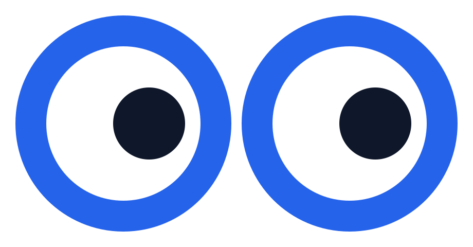

  

<h1 align="center">Whofindsyou</h1>

  Weekly measurements of how findable a website is, in Google and in AI assistants. 
  One honest score, built from real data only.

  <a href="https://whofindsyou.com">whofindsyou.com</a> ·
  <a href="https://whofindsyou.com/voorbeeldrapport/">Example report</a> ·
  <a href="https://app.whofindsyou.com/quickscan">Free quickscan</a>

---

## What we measure

Every week, for every site, across eight dimensions:

- **Technical SEO**: https, redirects, robots.txt, sitemap, canonicals, 404 behaviour
- **On-page SEO**: titles, meta descriptions, headings, alt texts, internal links, up to hundreds of pages per site
- **Performance**: Core Web Vitals via PageSpeed Insights and CrUX field data
- **Structured data**: detection and validation of Schema.org markup
- **Backlinks**: referring domains with a live check per source page. Links that only exist in a database do not count
- **Keywords**: clicks, impressions and positions from Google Search Console, plus our own measured keyword index
- **General hygiene**: the basics that break silently
- **AI visibility**: access for ten AI crawlers, citability of the content, llms.txt quality, and AI answers in Google

## Principles

- Only real measurements count. A provider outage is reported, never filled in with an estimate.
- The score has an honest zero. What is not measured does not count.
- Keywords are measured, never invented. No generated suggestions, no estimated volumes.

## Who it is for

Website owners and agencies in the Netherlands. Reports are written in plain Dutch, as a page and as PDF.
